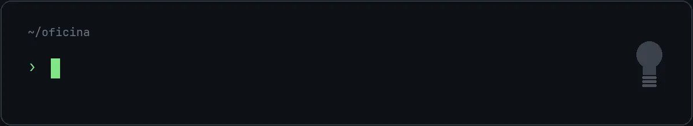

Gosto de ferramentas que resolvem um incômodo de verdade, de preferência um incômodo meu.
Às vezes vira app de desktop, às vezes app de celular, às vezes um mod de Minecraft.

**Coisas que fiz e uso**

- [ByteBapo](https://github.com/MatheusANBS/ByteBapo): conversar com IA local pelo celular, no Wi-Fi de casa.
- [Wireless-Automate](https://github.com/MatheusANBS/Wireless-Automate): logística no Minecraft sem nenhum cano.
- [TTT](https://github.com/MatheusANBS/TTT): olhar a memória de um processo em tempo real.
- [COMPLAT](https://github.com/MatheusANBS/COMPLAT): achar arquivos por lista e zipar em lotes do tamanho certo.

A animação sai de [`assets/make-hello.py`](./assets/make-hello.py). Pra mudar as frases, é só editar a lista.
